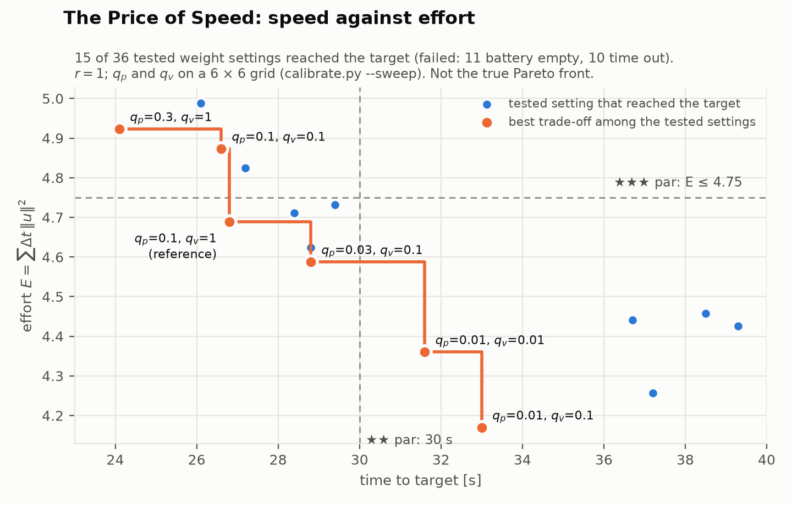

# ControlQuest: scientific motivation and measured results

ControlQuest is a simulation-based teaching game about **design trade-offs in model predictive
control (MPC)**. Every level uses the same 2D point mass and the same OCP recipe, and changes
one design choice: the cost weights, the horizon and terminal constraint, nonconvex obstacles,
or how often the controller re-plans under disturbances. The player sets the choice, runs the
real acados solver, and watches the closed loop succeed or fail.

This document states the research question behind each level, the formal problem the game
solves, what we measured, and how two recent papers per level treat the same problem. It is
**not** a robustness or safety proof, not a reproduction of the cited methods, and not an
evaluation of learning effectiveness. Our numbers come from our simulations; the papers'
contributions are paraphrased from their abstracts.

- Measured data: [`results/calibrate_2026-11-19.txt`](results/calibrate_2026-11-19.txt) (raw
  output, environment and commands), [`figures/price_of_speed_sweep.csv`](figures/price_of_speed_sweep.csv).
- The research brief this builds on (proposal and bibliography):
  [`SCIENTIFIC_UPGRADE_BRIEF.md`](SCIENTIFIC_UPGRADE_BRIEF.md). Where it and this document
  differ, this document reflects the built game (reduced scope, 2026-11-19).
- In the game, each level's **Research debrief** ("Insights" on the result card) shows the same
  question, the player's own run and the two papers.

## 1. The common setup

**Model** (what the controller predicts with). State $x = (p, v) \in \mathbb{R}^4$ (position,
velocity), input $u = a \in \mathbb{R}^2$ (acceleration), sampling time $\Delta t = 0.1$ s, exact
zero-order-hold discretisation of the double integrator:

$$p_{k+1} = p_k + \Delta t\, v_k + \tfrac{1}{2}\Delta t^2\, g\, u_k, \qquad v_{k+1} = v_k + \Delta t\, g\, u_k,$$

with model gain $g = 1$ in every level. The simulated "real" ball (plant) uses the same exact
step; Crosswind adds a wind acceleration to the plant only.

**OCP** solved at every re-plan from the measured state $\hat{x}$, target $x_\star = (p_\star, 0)$:

$$\min_{u_0,\dots,u_{N-1}} \; \sum_{k=0}^{N-1} \Delta t\,\Big(\|x_k - x_\star\|_Q^2 + \|u_k\|_R^2\Big) + \|x_N - x_\star\|_P^2 \;+\; \text{(penalty on the obstacle slacks } s\text{)}$$

subject to

- $x_0 = \hat{x}$, $\;x_{k+1} = f(x_k, u_k)$;
- $|a_x|, |a_y| \le a_{\max}$ and $|v_x|, |v_y| \le v_{\max}$ (box bounds **per axis**, so the speed
  $\|v\|$ can exceed $v_{\max}$, up to $\sqrt{2}\,v_{\max}$), workspace bounds $0 \le p \le 50$ m
  (hard: the "walls");
- obstacles (Dead End, Crosswind): $(p_k - c_j)^\top E_j (p_k - c_j) \ge 1 - s_{k,j}$, $s_{k,j} \ge 0$
  on the predicted positions: each block's minimum-area enclosing ellipse, enlarged by a
  margin. These constraints are **soft**: acados penalises the slack linearly (weight $10^4$, an
  exact L1 penalty) plus a small quadratic term (weight 10), because hard ellipse constraints
  made the QP solver fail when an ellipse and the input bounds were active together;
- Brake Check only, optional: the terminal constraint $v_N = 0$.

$Q = \mathrm{diag}(q_p, q_p, q_v, q_v)$, $R = r I$, $P = 10\,Q$. The stage cost is weighted by $\Delta t$
(acados `cost_scaling`), the terminal cost is not.

**Solver.** acados SQP with Gauss–Newton Hessian, HPIPM (partial condensing, robust mode),
QP tolerance $10^{-6}$, NLP tolerance $10^{-4}$, at most 50 SQP iterations; Levenberg–Marquardt
damping $10^{-2}$ when a level has obstacles. Warm start: the previous plan shifted by one step
(its last input repeated). Without obstacles the OCP is a convex QP (one SQP iteration). A plan
is used only if it is finite and inside all bounds; plans must also stay outside the ellipses
(allowing $h \ge 0.98$), except that in Crosswind converged plans are not checked against the
ellipses (a gust can push the ball into an ellipse; the soft constraint then leads the plan out,
and only touching a block is a crash). A solve that stops at the SQP iteration limit is used only if
its plan passes all these checks, the ellipse check included. Every other solver failure ends
the run as "controller failure"; there is no fallback controller.

**Closed loop and rules outside the OCP.** The run ends on success ($\|p - p_\star\| < 0.05$ m and
$\|v\| < 0.05$ m/s), time out, controller failure, a crash (the ball's path enters a block,
checked between samples, or leaves the field) or a level budget. Level 1's battery and
Crosswind's solve budget are **game rules that stop the run**, not constraints in the OCP.

**Determinism.** No randomness except Crosswind's wind, which uses a fixed seed. Two runs with
the same settings gave identical trajectories (checked 2026-11-19 for Level 1's default and
Crosswind's reference).

**How the numbers were measured.** With the existing `game/engine_server/calibrate.py` in the
course Docker image (commands and environment in the log). "Time" is the time to the target for
a success and the time until the run stopped otherwise; "mean solve" is acados' solver time per
OCP (`time_tot`, i7-13700HX in Docker on Windows 11). Solve times depend on the machine and vary
between runs (e.g. N = 100 measured faster than N = 60 in Dead End); compare them only roughly.

## 2. Levels

### Level 0 "Hello, MPC" (tutorial): the receding-horizon loop

**Research question.** How does solving one optimisation problem again and again become a
feedback controller, and why does every solve have to be fast?

**In the game.** A guided tour of one round of the loop: measure $\hat{x}$, predict with the
model, optimise the input sequence, apply only $u_0$, repeat. 20 m field, ball at rest, $N = 30$
(3 s), all weights 1. No stars.

**Measured.** Target reached after 10.0 s with 100 solves (one every 0.1 s), 0.58 ms per solve.

**Papers.**
- [0A] J. Frey, K. Baumgärtner, G. Frison, M. Diehl (2025). *Multi-Phase Optimal Control
  Problems for Efficient Nonlinear Model Predictive Control With acados.* Optimal Control
  Applications and Methods 46(2), 827–845. https://doi.org/10.1002/oca.3234 (arXiv:
  https://arxiv.org/abs/2408.07382). A multi-phase OCP interface for acados that lets different
  parts of the horizon use different discretisations, models and input parametrisations, so a
  solver spends accuracy where it matters. Relation: ControlQuest uses acados for a single-phase
  OCP.
- [0B] M. Krinner, A. Romero, L. Bauersfeld, M. Zeilinger, A. Carron, D. Scaramuzza (2024).
  *MPCC++: Model Predictive Contouring Control for Time-Optimal Flight with Safety Constraints.*
  Robotics: Science and Systems (RSS) 2024.
  https://roboticsconference.org/2024/program/papers/109/ (arXiv:
  https://arxiv.org/abs/2403.17551). Drone racing with a track constraint and terminal set for
  safety, a model with a residual learned from flight data, and Bayesian optimisation of the
  controller's parameters. Relation: a demanding real use of the same loop.

**Limits.** The model is exact and nothing disturbs the ball, so re-planning has nothing to
correct here. The game computes the run first and replays it; the replay says nothing about
real-time execution.

### Level 1 "The Price of Speed": tuning the cost is a multi-objective problem

**Research question.** How do the MPC weights trade off competing goals, and why is tuning
them an optimisation problem of its own?

**In the game.** The player sets $q_p$, $q_v$, $r$ (each 0.001–50). A battery holds an effort budget
$E = \sum \Delta t\,\|u_k\|^2 \le 5$ (units m²/s³; an actuation-effort measure, not energy in joules);
the run stops when it is used up. Time limit 40 s; ★★ within 30 s; ★★★ also $E \le 4.75$.

**Measured.**

| Weights $(q_p, q_v, r)$ | Outcome | Time | $E$ |
|---|---|---|---|
| (10, 1, 0.1), default | battery empty, 0.51 m before the target | 20.3 s (stopped) | 5.22 |
| (1, 0.1, 0.01) = default × 0.1 | battery empty, 0.51 m before the target | 20.3 s (stopped) | 5.22 |
| (30, 3, 0.3) = default × 3 | battery empty, 0.51 m before the target | 20.3 s (stopped) | 5.22 |
| (0.1, 1, 1), reference | success ★★★ | 26.8 s | 4.69 |
| (1, 10, 10) = reference × 10 | success ★★★ | 26.8 s | 4.69 |

Scaling all weights by one factor gave the same outcome, time and effort, as the theory says
(the minimiser of a cost does not change when the cost is multiplied by a positive number;
solver tolerances can still cause tiny differences).

Sweep (`calibrate.py price_of_speed --sweep`, $r = 1$, $q_p, q_v$ on a 6 × 6 grid): **15 of 36**
settings reached the target, 11 emptied the battery, 10 timed out. Five reached ★★★:
$(q_p, q_v)$ = (0.1, 1) 26.8 s / 4.69, (0.3, 3) 28.4 s / 4.71, (0.03, 0.1) 28.8 s / 4.59,
(0.03, 0.01) 28.8 s / 4.62, (1, 10) 29.4 s / 4.73.

The orange points are the **best trade-offs among the tested settings** (no tested setting is
both faster and cheaper). This is not the controller's true Pareto front: only 36 settings were
tested, and failed runs have no time to target, so they are not plotted. Figure:
`python docs/figures/make_price_of_speed_pareto.py` (host, reads the CSV).

**Interpretation.** Aggressive weights (default) accelerate and brake at full power and run out
of effort; very gentle ones creep and time out; in between there is a family of settings that
trade a few seconds against a few percent of effort. The cost value itself cannot rank
settings, because it changes with the weights; the external measures (time, effort) can.

**Papers.**
- [1A] D. Stenger, R. Ritschel, F. Krabbes, R. Voßwinkel, H. Richter (2023). *What Is the Best
  Way to Optimally Parameterize the MPC Cost Function for Vehicle Guidance?* Mathematics 11(2),
  465. https://doi.org/10.3390/math11020465. MPC tuning for vehicle guidance as multi-objective
  optimisation over expensive closed-loop simulations, some of which fail; compares particle
  swarm, NSGA-II and Bayesian optimisation. Relation: every player run is one evaluation of a
  weight vector, as in black-box tuning.
- [1B] M. Abtahi, M. Rabbani, S. Nazari (2023). *An Automatic Tuning MPC with Application to
  Ecological Cruise Control.* IFAC-PapersOnLine 56(3), 265–270.
  https://doi.org/10.1016/j.ifacol.2023.12.035 (arXiv: https://arxiv.org/abs/2309.09358).
  Offline dynamic programming, inverse optimisation for matching MPC weights, and a neural
  network that sets the weights online for a fuel-saving cruise control. Relation: the weights
  decide how much actuation the closed loop uses.

**Limits.** Effort measure instead of a physical energy model; the battery is an external stop
rule; a 6 × 6 grid, one run per setting.

### Level 2 "Brake Check": recursive feasibility and terminal constraints

**Research question.** How can an OCP that is feasible now become infeasible later, and how
does a terminal constraint keep it feasible?

**In the game.** A fast ball ($v_{\max} = 4$ m/s per axis) with weak brakes ($a_{\max} = 1$ m/s²)
must stop on a target 2 m in front of the wall (x = 50 m, a hard state bound). Braking from
full speed takes 4 s and 8 m. Weights fixed ($q_p = 10$, $q_v = 1$, $r = 0.1$). The player picks
$N \in \{5, 10, 20, 30, 40, 60\}$ and the terminal stop $v_N = 0$. ★★ within 27 s; ★★★ also $N \le 20$.

**Measured.**

| $N$ (horizon) | stop | Outcome | Time | mean solve |
|---|---|---|---|---|
| 5 (0.5 s) | off | controller failure | 13.3 s (stopped) | 0.15 ms |
| 10 (1 s), default | off | controller failure | 13.0 s (stopped) | 0.31 ms |
| 20 (2 s) | off | controller failure | 13.2 s (stopped) | 0.56 ms |
| 30 (3 s) | off | success ★★ | 17.2 s | 0.81 ms |
| 40 (4 s) | off | success ★★ | 16.6 s | 1.08 ms |
| 60 (6 s) | off | success ★★ | 17.2 s | 1.67 ms |
| 5 | on | time out, 20.1 m left | 60.0 s (stopped) | 0.13 ms |
| 10 | on | success ★ | 49.9 s | 0.26 ms |
| 20, reference | on | success ★★★ | 25.1 s | 0.56 ms |
| 30 | on | success ★★ | 19.3 s | 0.92 ms |
| 40 | on | success ★★ | 16.8 s | 1.31 ms |
| 60 | on | success ★★ | 17.2 s | 1.65 ms |

Default run in detail: at $t = 11.6$ s the ball was 7.6 m from the wall at 4.0 m/s; braking needs
8.0 m, the 1 s horizon reached about 4 m. From then on no input sequence could stop it before
the wall; at 13.0 s the solver reported acados status 4 (QP solver failure).

**Interpretation.** Without the terminal stop a short horizon lets the ball build up speed it
cannot shed in time; the failure comes several seconds later, when the wall enters the plan. The
failure is reported by the solver; the evidence that no feasible plan existed is physical
(braking distance against the room left). With $v_N = 0$ every plan contains a stop. Rest is a
control invariant set here ($u = 0$ keeps the ball at rest within all constraints), so with the
exact model the shifted previous plan extended by one resting step stays feasible: recursive
feasibility. The price is a speed limit of about $a_{\max} N \Delta t$, hence slow runs for short
$N$. A long horizon also works without the stop, at a higher cost per solve.

**Papers.**
- [2A] M. E. Geurts, A. Katriniok, E. Silvas, N. J. Brouwer, W. P. M. H. Heemels (2025).
  *Model Predictive Control for Lane Merging Automation With Recursive Feasibility Guarantees
  and Its Experimental Validation.* IEEE Transactions on Control Systems Technology 33(2),
  566–581. https://doi.org/10.1109/TCST.2024.3485306. An MPC (mixed-integer QP) for merging in
  mixed traffic with terminal sets designed to guarantee recursive feasibility and constraint
  satisfaction; validated experimentally. Relation: the same role as $v_N = 0$.
- [2B] Z. Zhao, A. Girard, S. Olaru (2024). *Nonlinear model predictive control based on K-step
  control invariant sets.* European Journal of Control 80, 101040.
  https://doi.org/10.1016/j.ejcon.2024.101040. K-step control invariant sets, computed with
  symbolic control, as terminal constraints for nonlinear MPC. Relation: rest is a trivial
  invariant set; for nonlinear systems such sets are hard to compute.

**Limits.** The guarantee rests on an exact model and no disturbances. Feasibility is not
stability or real-world safety. Motion is along x, so the per-axis bounds act like 1D bounds.

### Level 3 "Dead End": nonconvex constraints and local solvers

**Research question.** Why can a local optimiser miss a route that exists, and is looking
further ahead enough to escape a trap?

**In the game.** A U-shaped wall (six blocks, soft ellipse constraints, margin 0.2 m) opens
towards the start; weights fixed. The player tries one fix at a time: ① a longer horizon (any
$N$ from 5 to 300) or ② up to 3 waypoints (the reference switches to the next one within 2 m).
★★ within 28 s; ★★★ also at most 1 waypoint.

**Measured.**

| Fix | Outcome | Distance left | mean solve |
|---|---|---|---|
| none ($N = 30$) | time out (45 s) | 15.2 m | 1.27 ms |
| horizon $N = 60$ | time out (45 s) | 15.2 m | 1.79 ms |
| horizon $N = 100$ | time out (45 s) | 15.2 m | 1.68 ms |
| horizon $N = 150$ | time out (45 s) | 15.2 m | 3.03 ms |
| waypoint (35, 40), reference | success ★★★, 25.2 s | – | 1.20 ms |
| waypoint (22, 42) | time out (45 s) | 18.4 m | 1.18 ms |

Every horizon stopped at the same point, 0.19 m from the back wall.

**Interpretation.** With obstacles the OCP is nonconvex. SQP improves its starting guess (the
shifted previous plan) locally; once the plans lead into the U, every solve converges to the
same plan in front of the wall and the ball stops. More foresight did not change that here and
only made each solve slower. A suitable waypoint changes the reference, and the same local MPC
then finds the way; a badly placed one leads into the trap again.

**Papers.**
- [3A] S.-M. Lee (2025). *Global-Initialization-Based Model Predictive Control for Mobile Robots
  Navigating Nonconvex Obstacle Environments.* Actuators 14(9), 454.
  https://doi.org/10.3390/act14090454. A particle-swarm global search provides the optimiser's
  initial guess when needed, to escape local minima; compared with a conventional IPOPT-based
  MPC in ROS/Gazebo simulations. Relation: the same failure; the game changes the reference,
  the paper the starting point.
- [3B] K. S. Narkhede, A. M. Kulkarni, D. A. Thanki, I. Poulakakis (2022). *A Sequential MPC
  Approach to Reactive Planning for Bipedal Robots Using Safe Corridors in Highly Cluttered
  Environments.* IEEE Robotics and Automation Letters 7(4), 11831–11838.
  https://doi.org/10.1109/LRA.2022.3204367 (arXiv: https://arxiv.org/abs/2205.00156; the
  preprint has a shorter title). A safe corridor of obstacle-free polytopes with waypoints and a
  sequence of MPC problems; simulations with the robot Digit. Relation: automatic waypoints.

**Limits.** That all tested horizons got stuck is what happened on this map, not a proof that a
longer horizon never helps. Waypoints are placed by the player, not by a global planner. A third
fix (a learned or exact cost-to-go) was explored in a spike and dropped (AGENTS.md section 6).

### Level 4 "Crosswind": feedback, disturbances and how often to re-plan

**Research question.** How often must an MPC re-plan to keep useful feedback under
disturbances, when computation is limited?

**In the game.** Wind (in $+y$: constant 0.3 m/s² plus gusts uniform in ±0.6 m/s², each held
1 s, seed 7) pushes the real ball; the model does not know it. The OCP is solved every $k$ samples
($k \in \{1, 2, 3, 5, 10, 20\}$); in between the next inputs of the last plan are applied open-loop.
Budget 60 solves (the run stops when it is used up), time limit 35 s; ★★ within 30 s; ★★★ also at
most 35 solves. The player also sets the obstacle margin $m$. "Drift" is the distance between the
ball and the plan being executed; it is 0 at every re-plan, and always 0 for $k = 1$.

**Measured** (outcome · time · solves · max drift):

| $k$ | margin 0.1 m | margin 0.3 m |
|---|---|---|
| 1 (default) | budget used up · 6.0 s · 60 · 0.00 m | budget used up · 6.0 s · 60 · 0.00 m |
| 2 | budget used up · 12.0 s · 60 · 0.00 m | budget used up · 12.0 s · 60 · 0.00 m |
| 3 | budget used up · 18.0 s · 60 · 0.02 m | budget used up · 18.0 s · 60 · 0.02 m |
| 5 | crash · 9.1 s · 19 · 0.06 m | **success ★★ · 28.1 s · 57 · 0.07 m** |
| 10 | crash · 9.2 s · 10 · 0.31 m | **success ★★★ · 28.2 s · 29 · 0.36 m** (reference) |
| 20 | crash · 9.1 s · 5 · 1.33 m | crash · 10.1 s · 6 · 1.33 m |

(Times of failed runs are the time until the run stopped.)

**Interpretation.** Frequent re-planning keeps the drift small but uses up the budget long
before the target. Rare re-planning saves solves, but the wind pushes the ball up to 1.3 m off
its plan between re-plans, into a block. Only intermediate $k$ together with a margin that
leaves room for the drift between re-plans succeeds; with $m = 0.1$ m no tested $k$ did. One fixed
$k$ must suit the most demanding part of the run.

**Papers.**
- [5A] P. Li, T. Wang, Y. Kang, K. Li, Y.-B. Zhao (2022). *Event-based model predictive control
  for nonlinear systems with dynamic disturbance.* Automatica 145, 110533.
  https://doi.org/10.1016/j.automatica.2022.110533. Event-triggered and self-triggered MPC
  with disturbance prediction: the OCP is solved only at triggering instants, decided from the
  state prediction error and the predicted disturbance. Relation: decides *when* to re-plan,
  instead of a fixed $k$.
- [5B] P. Conrad, K. Graichen (2024). *A Sensitivity-Based Approach to Self-Triggered Nonlinear
  Model Predictive Control.* IEEE Access 12, 153243–153252.
  https://doi.org/10.1109/ACCESS.2024.3480522. The next sampling time follows from the
  sensitivity of the MPC cost, with a cost-decrease condition that guarantees asymptotic
  stability. Relation: an adaptive $k$.

**Limits.** Fixed-interval re-planning, not event- or self-triggered MPC (not built, by
decision). The budget counts solves, not computing time. One wind realisation (fixed seed): the
table shows this wind, not all winds. The margin is a heuristic buffer, not a robust (tube) MPC.

## 3. References: how they were checked

All ten were checked on 2026-11-19 against Crossref (DOI metadata: title, authors, venue,
volume, pages, year), arXiv (where a preprint exists) and the RSS 2024 programme page ([0B] has
no DOI listed). Abstracts were read from Crossref, arXiv or Semantic Scholar; the summaries
above and in the game paraphrase those abstracts only. Corrections to the brief: [1A] has five
authors (F. Krabbes was missing); [3B]'s preprint title is shorter than the published one.
Section, figure or result claims from the brief that are not in the abstracts are not used.

## 4. What this project does not claim

- It does not reproduce or outperform any cited method; the papers are context for the levels.
- Its numbers come from one deterministic simulation per setting on one machine; they illustrate
  the trade-offs, they are not statistics.
- Recursive feasibility in Brake Check holds for the exact model without disturbances only; no
  level makes stability or real-world safety claims.
- No study of learning effectiveness was done.
